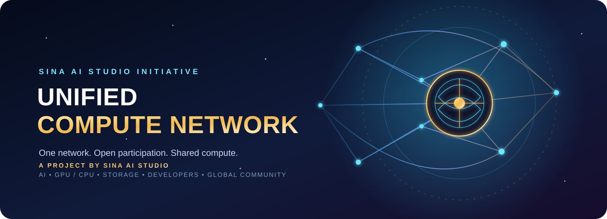

# Unified Compute Network (UCN)

**A global, community-shaped compute and AI services network initiated by SINA AI STUDIO.**

> **One network. Open participation. Shared compute.**



Unified Compute Network (UCN) is an initiative within the **SINA AI STUDIO ecosystem**. Its vision is to bring independent AI providers, compute operators, infrastructure owners, developers, researchers, businesses, and users into one interoperable network.

SINA AI STUDIO is the initiator of UCN. The network is intended to grow through open participation: providers can contribute services and resources, developers can build integrations, users can access competing services through a unified experience, and the global community can review and shape the architecture, economics, standards, and governance.

**The vision is proposed by SINA AI STUDIO; the community is invited to challenge it, improve it, and help complete it.** No single provider should define the future of the network.

## The vision

Today, access to AI and compute is fragmented across many providers, APIs, models, platforms, prices, accounts, and technical requirements. UCN aims to make that fragmented landscape work more like one open marketplace and shared resource network.

A user should be able to describe the outcome they need—not understand model names, provider APIs, infrastructure, or routing rules. The network should discover eligible services, compare cost, quality, latency, availability, and user requirements, then coordinate execution through an intelligent orchestration layer.

Providers should remain independent and compete on the value they deliver. They may contribute different models, APIs, GPUs, CPUs, storage, rendering capacity, or other digital services. The network should make it possible to discover, combine, compare, and use those resources through common interfaces.

The long-term ambition is broader than an API gateway: **a community-driven marketplace and pooling layer for AI services and shared compute.**

## What UCN is exploring

The following are areas for community research, design, prototyping, and validation—not claims that every capability is already implemented or production-ready.

- **Unified provider access:** common interfaces and adapters for independent providers and infrastructure.
- **Intelligent orchestration:** route each request to a suitable service based on task complexity, quality needs, price, latency, capacity, reliability, and user preferences. Use the least costly option that meets the required quality; escalate only when needed.
- **Open service competition:** let providers compete on price, quality, speed, availability, and specialization. Users should not need to understand the underlying model or provider.
- **Shared resource and service pools:** explore pools for inference, text, image, video, 3D, GPU/CPU compute, storage, and other capabilities.
- **Market-based pricing:** explore transparent price discovery based on supply, demand, comparable service quality, and actual resource costs.
- **Swap and liquidity mechanisms:** research whether and how shared pools, liquidity provision, staking, and swaps can support a common network economy.
- **A common SINA network token:** explore a single unit for service pricing, exchange, and settlement across the ecosystem. A defined supply and monetary backing, potentially targeting full backing and redemption, are design goals to be independently assessed—not guarantees or an issued financial product.
- **Community governance:** let contributors and participants propose, debate, test, and adopt better technical and economic designs through transparent processes.

The community is free to propose a different architecture when it can serve the network better. These themes are starting points for discussion, not a closed specification.

## Principles

1. **Open participation:** welcome providers, developers, researchers, users, and organizations from around the world.
2. **Provider independence:** no provider should be able to dictate the network's direction or block fair competition.
3. **User-first experience:** users express goals and constraints; orchestration handles technical complexity.
4. **Competition and choice:** compare services using meaningful evidence, not brand recognition alone.
5. **Transparency:** make pricing, resource usage, routing policies, rewards, and governance decisions understandable and auditable.
6. **Interoperability:** prefer documented interfaces, portable adapters, and open standards.
7. **Verifiable contribution:** rewards and reputation should reflect useful, measurable work—not merely registration or self-reported capacity.
8. **Security and accountability:** protect credentials, verify provider behavior, handle failures honestly, and prevent abuse.
9. **Community evolution:** no initial design is beyond review. Better proposals can replace earlier assumptions through an open process.

## A starting proposal from SINA AI STUDIO

SINA AI STUDIO is opening the project with several proposed principles for community review:

- SINA AI STUDIO initiates the network and proposes a maximum 30% governance share for itself.
- No individual provider should hold more than 20% of governance power.
- An 8% allocation of network value at official launch is proposed for developers. Developers and the community should help determine the allocation, distribution, and use mechanism.
- A further 2% reward from SINA AI STUDIO's own equity is proposed for active developers, subject to a transparent, verifiable program and the necessary legal arrangements.

These are proposals to be openly discussed and refined. They are not implemented tokenomics, issued equity, an offer of securities, or a promise of financial return. Definitions, eligibility, valuation, vesting, legal structure, and implementation must be established before any launch or distribution.

## How the network could work

A possible end-to-end flow for discussion:

1. A user describes a task and their desired quality, budget, and timing.
2. The orchestrator interprets the request and identifies suitable capabilities.
3. The network discovers eligible providers and available pooled resources.
4. Routing compares verified price, quality, latency, capacity, reliability, and applicable user preferences.
5. The selected provider performs the work; the network verifies and records the result and usage where technically possible.
6. Settlement, provider compensation, network fees, and any pool accounting follow transparent rules approved for the network.

This is a conceptual flow. The complete protocol, verification model, settlement rules, and pool mechanics remain open for community design and testing.

## Community questions — join the discussion

We are opening the design process now. These first questions are invitations to developers, providers, researchers, and users—not decisions already made by the project.

- [**Question 1: Which real-world workload should UCN solve first?**](https://github.com/sina6565/Unified-Compute-Network/issues/3)
- [**Question 2: How should UCN compare and verify provider quality?**](https://github.com/sina6565/Unified-Compute-Network/issues/4)

Add your evidence, alternatives, prototypes, and constructive criticism directly to the discussions. You do not need to agree with the initial vision to contribute.

## Join the community

UCN is looking for:

- AI model and API providers;
- GPU, CPU, storage, rendering, and compute operators;
- open-source infrastructure and protocol projects;
- developers building provider adapters, orchestration, security, monitoring, and user experiences;
- researchers in distributed systems, market design, cryptography, and governance;
- users and organizations willing to test real workloads and give evidence-based feedback.

You do not need to agree with the initial proposal to participate. Critical review and better alternatives are welcome.

**Ways to contribute**
- Open an issue to identify a problem, ask a question, or propose an improvement.
- Submit a pull request with code, tests, documentation, or a prototype.
- Compare existing open-source projects and standards that UCN could reuse.
- Propose provider integrations and document their real capabilities, limits, pricing, and terms.
- Help design transparent service benchmarks, pool accounting, token economics, and governance.
- Share test results, including failures and limitations.

Please explain the problem, evidence, trade-offs, and expected benefit in proposals. For major architectural or economic decisions, start with an issue so the community can discuss alternatives before implementation.

## Current repository status

This repository currently contains an early adapter-focused implementation and research catalog. It is **not yet a complete unified compute network**.

Currently present:
- a shared provider-adapter contract;
- opt-in Groq chat and Google Gemini text adapters;
- an opt-in Pollinations image adapter;
- a provider catalog that distinguishes implemented adapters from planned integrations;
- initial adapter and gateway tests.

Still requiring design and implementation:
- production-ready gateway and provider discovery;
- capability-aware orchestration and routing;
- provider benchmarking, health, reliability, and usage verification;
- shared pools and resource coordination;
- metering, accounting, settlement, and billing;
- liquidity pools, Swap, staking, and token infrastructure;
- governance, contribution rewards, and community decision processes;
- production security, monitoring, abuse prevention, and operational controls.

Provider availability, free quotas, model capabilities, commercial-use rights, and service terms change. Every integration must be checked against current official documentation and applicable terms before activation. A listed or proposed provider is not necessarily implemented, available, free, or approved for commercial use.

## Development

Requires Node.js 22+ and pnpm 9+.

```bash
pnpm install
pnpm test
pnpm typecheck
```

See [provider status and validation](docs/PROVIDER_STATUS.md) and [architecture notes](docs/ARCHITECTURE.md).

## Help shape what UCN becomes

The next architecture should not be decided behind closed doors. Open an issue with your proposal, challenge the assumptions in this README, and help the community define a network that is useful, fair, interoperable, and sustainable.

**UCN starts with an initiative from SINA AI STUDIO. Its future should be shaped by the people who build it, provide resources to it, and use it.**
